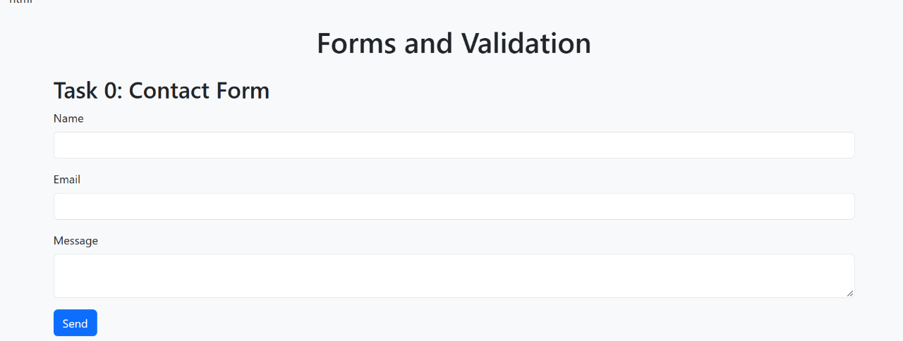
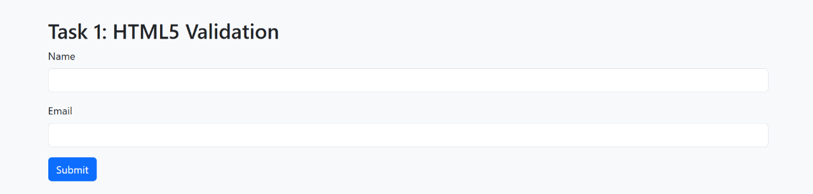
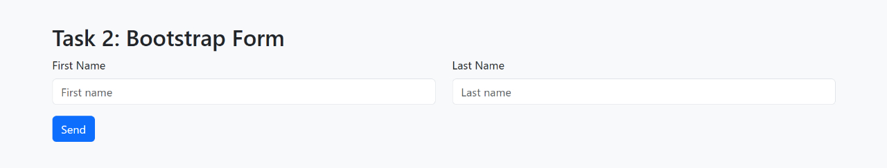
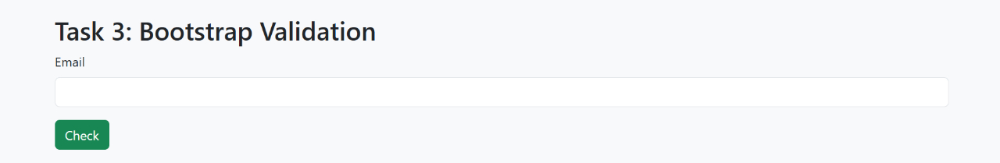
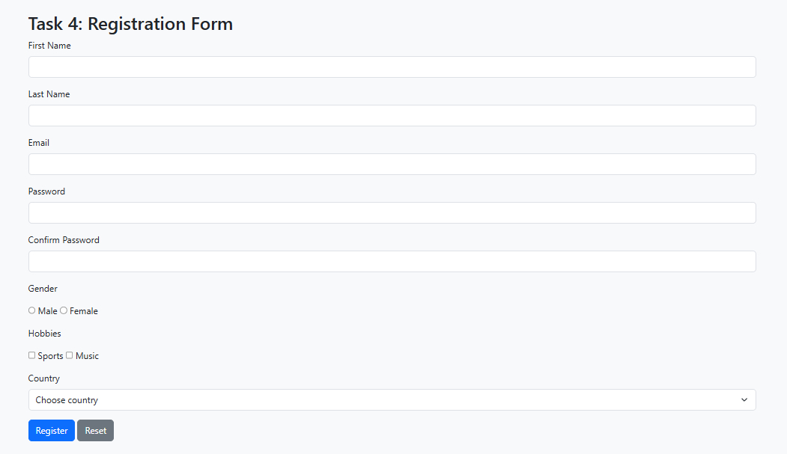

# Assignment 4: Forms and Validation

**Name:** Temirlan Nurshaikhinov
**Group:** SE-2539

## Task 0: Contact Form
Created a simple contact form with name, email, and message fields.

## Task 1: HTML5 Validation
Added HTML5 validation for required fields and email format.

## Task 2: Bootstrap Form
Used Bootstrap classes and grid system to style the form.

## Task 3: Bootstrap Validation
Added validation feedback for the email field.

## Task 4: Registration Form
Created a registration form with personal information, gender, hobbies, and country selection.

## Summary
I created forms using HTML5 and Bootstrap. I added validation and tested the forms in the browser.